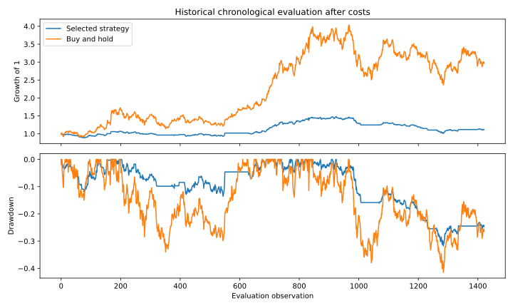

# Systematic Strategy Research

## Question and architecture
Can a simple family of causal, volatility-scaled rules improve a buy-and-hold benchmark after trading costs? This project deliberately publishes underperformance instead of hiding it with retrospective tuning.

`engine.py` separates signal formation, portfolio accounting, metrics and chronological selection. Nine candidates combine momentum, mean-reversion or moving-average trend filters with 21/63/126-observation windows. Selection uses the preceding 504 observations and holds the selected specification for the next 126 observations; weights still update causally each day.

## Timing and mathematics
Both rule selection and signal formation exclude the execution close. The initial evaluation starts at index 505 so the training window ends at index 503. Signal for interval (t−1,t] uses only prices through t−2, executes at close t−1, and earns the t return. Raw positive signals are inverse-volatility weighted; ex-ante covariance is estimated through portfolio return history. Gross exposure is capped at 1 and scaled toward 12% annual volatility. No shorts or leverage; cash earns zero.

Turnover = Σ|target weight−drifted prior weight|. Net return = (1−cost×turnover)(1+target weights·asset returns)−1. Holdings drift after market returns. Initial deployment and terminal liquidation costs are included. Training scores also start from cash and include liquidation. The benchmark is initially equal-weight buy-and-hold with drifting holdings, not daily rebalanced equal weighting.

## Historical results
Fixed DLF/Godrej Properties/Prestige/Oberoi universe, vendor-adjusted prices: 1,422 evaluation observations, 1.95% strategy CAGR, 0.24 Sharpe (zero risk-free), −31.78% maximum drawdown. Buy-and-hold CAGR is 21.29%, Sharpe 0.78 and drawdown −41.50%. The strategy reduced exposure/drawdown but materially underperformed; it has not demonstrated positive excess return.

The paired 20-observation block bootstrap uses 1,000 resamples. The annualized mean-return difference interval is approximately −40.30% to −3.14%. It is conditional on this already-selected research path and does not correct model-search or universe-selection bias.



## Data and commands
Historical source: Yahoo Finance adjusted close for [DLF](https://finance.yahoo.com/quote/DLF.NS/history/), [Godrej Properties](https://finance.yahoo.com/quote/GODREJPROP.NS/history/), [Prestige](https://finance.yahoo.com/quote/PRESTIGE.NS/history/), [Oberoi](https://finance.yahoo.com/quote/OBEROIRLTY.NS/history/), accessed 2026-10-24. Exact input hash, date bounds and assumptions: `results/historical/summary.json`. Obtain authorized data locally with Date and these four symbol columns; then `python run.py --prices /path/to/prices.csv`. Raw vendor data are not committed. Default `run.py` generates a seeded correlated geometric fixture, source in the generator, and writes `results/synthetic` separately.

## Validation and limitations
12 tests cover future mutation, chronological selection, self-financing accounting, deployment/liquidation fees, cash, invalid data, bounds and drawdown. Five fee scenarios are published without re-selecting rules. Survivor-universe bias, adjusted-close execution, simplified volatility estimation, taxes, liquidity and capacity remain unresolved. Retrospective pseudo-OOS is not a genuinely unseen live test.

Reference: [CME-hosted backtesting research](https://www.cmegroup.com/content/dam/cmegroup/education/files/backtesting.pdf), accessed 2026-10-24, motivates reporting selection bias and multiple-testing limitations.

## Evidence and interpretation

All generated inputs are assumptions, not empirical observations. Historical experiments are retrospective research, not a live track record. No employer sponsorship or investment recommendation is implied. Code was developed with AI assistance; the candidate must be able to reproduce, explain and modify it in interviews.

Source names, URLs and access dates are recorded in results JSON and the inherited methodology. Raw vendor price data are not redistributed. Use a lawfully obtained local CSV to reproduce historical runs; the default reproduction is fully offline; synthetic experiments and cached derived historical outputs are identified separately.

## Reproduce and test

Python 3.12:
```bash
python -m pip install -r requirements.txt
python reproduce.py
```
GitHub Actions runs the same research entry point. Historical caches are deliberately excluded from CI. Generated CSVs are the audit trail; SVG figures are derived from those CSVs or the same in-memory results.
