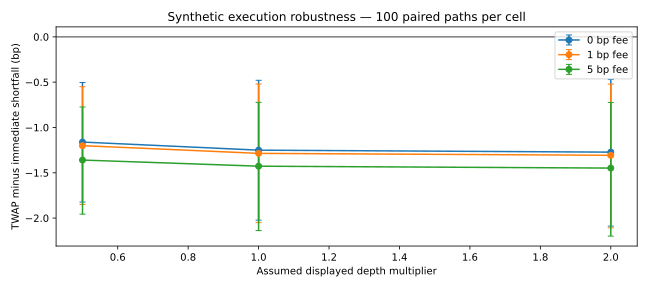

# Quant Execution Lab

**Price-time matching, transactional replay and paired execution-quality research.**

A reproducible Python engineering project by Anjaney Malhotra, developed with AI coding assistance. The research question is how execution scheduling changes fill quality under a shared, explicitly assumed liquidity process. It is an educational simulator, not exchange infrastructure or a claim of profitable trading.

## Results and reviewer entry points
- **20 passing tests**, including an independent list/sort matching oracle over **5,000 events** and conservation of submitted quantity.
- GTC and IOC orders, FIFO at each price, partial fills, cancellation and integer ticks.
- SQLite event persistence, idempotent retry, conflicting-event rejection, deterministic restart replay and corruption detection.
- **100 paired scenarios / 200 executions**, comparing aggressive immediate scheduling with cumulative TWAP. A seeded 2,000-resample paired bootstrap reports uncertainty.
- In this synthetic generator, TWAP minus immediate shortfall averages **−1.286 bp** (conditional 95% bootstrap interval **−2.050 to −0.521 bp**). This is not a market-performance result. Liquidity replenishment assumptions materially favour spreading orders.

## One-command reproduction
Python 3.12, standard library only:
```
python reproduce.py
```
This runs all tests, generates the 10,000-event deterministic matching benchmark, verifies a 250-event SQLite restart, then regenerates the paired execution study. Results carry seeds, assumptions and hashes. No credentials, market-data subscription or brokerage connection.

## Architecture
| File | Responsibility |
|---|---|
| book.py | Price heaps, per-price FIFO queues, validation, matching and SQLite event log |
| test_book.py | Independent reference matching, quantity conservation, invalid input, replay and retry tests |
| experiments.py | Synthetic depth snapshots, buy-parent scheduling, fees and opportunity-cost accounting |
| test_execution.py | Hand calculations, budget invariant, no-fill cost, fee direction and pairing |
| run.py | Seeded matching benchmark; machine-specific timings exclude persistence/networking |
| results/execution_trials.csv | Every policy/seed observation, including fill rate and unfilled opportunity cost |
| results/execution_analysis.json | Paired interval, assumptions and source hash |

## Execution model and equations
Both policies see exactly the same 20-step market path per seed. Each step has three independent replenished ask levels. Immediate scheduling attempts all remaining units at each step; TWAP targets floor(parent × elapsed steps / total steps) and catches up on earlier missed fills. Both use IOC child orders and a fixed arrival-mid + 10 tick limit. Parent quantity is 100 units; fees are assumed 1 bp.

Implementation shortfall (buy) = [executed notional − filled quantity × arrival mid + fees + unfilled quantity × (terminal mid − arrival mid)] / (parent quantity × arrival mid) × 10,000.

The last term values missed execution; it is not a forced fill. Buy-only is intentional. Limits and accounting must be extended and tested before a sell-side claim. Timing output measures the matching loop only; no microsecond production-latency claim.

## Data, assumptions and limitations
Named source: [public generator](https://github.com/Anjaney336/quant-execution-lab/blob/main/experiments.py). Generated/access date: **24 October 2026**. Mid starts at 10,000 ticks and takes uniformly sampled increments −3 through +3; spreads 1–3 ticks; depth 5–20 per level. All inputs are synthetic assumptions. No scraping, proprietary data or live trades.

Snapshots reset depth, so there is no persistent impact, adverse-selection model, strategic interaction or empirical calibration. The paired interval measures generator uncertainty, not profitability or transfer to an actual venue. The engine is single-instrument and single-writer; no concurrency, order amendment, auctions, self-trade prevention or distributed recovery. Hash chains are unauthenticated. Database copy-on-write state prioritises clarity over throughput. See ENGINE_DESIGN.md for recovery and admission details.

## Interview demonstration
Explain FIFO after partial fills; derive quantity conservation; reproduce the no-fill opportunity-cost test; show a conflicting retry being rejected; then change depth assumptions and explain why the policy comparison changes. Review and reproduce the code before claiming independent mastery.

## Execution robustness extension

1,800 simulated policy executions across 9 depth/cost cells, with paired intervals and fill rates. No real execution advantage is inferred.



Run `python robustness.py` after installing `matplotlib==3.10.7`. Sources are the existing documented fixture/ledger, accessed 24 October 2026. All sensitivity inputs are assumptions.
